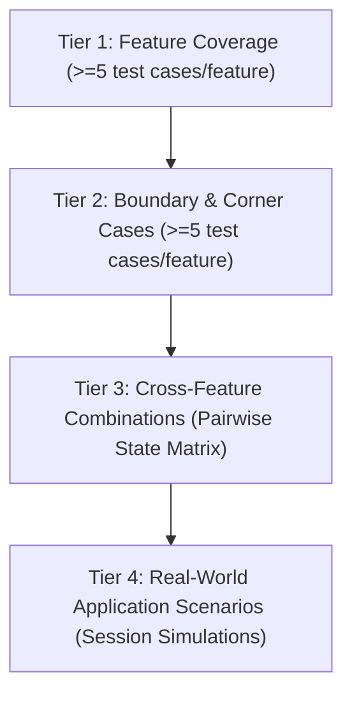

# 🛡️ Phyrexian Forge: E2E Test Infrastructure & Test Plan (TEST_INFRA.md)

**Document Version**: 1.0.0
**Project**: Phyrexian Forge — QA Audit Defects & GitHub Issues Resolution
**Status**: APPROVED & ACTIVE
**Tracking Requirements**: R1, R2, R3 (ORIGINAL_REQUEST.md), Features F1–F16 (PROJECT.md)
**Author**: E2E Test Writer (E2E Testing Track)

---

## 1. Test Philosophy

### 1.1 Opaque-Box & Requirement-Driven Architecture
The Phyrexian Forge End-to-End (E2E) testing suite operates under an **opaque-box, requirement-driven methodology**. Test cases are derived strictly from user requirements, formal rulesets (D&D 5e / 5.5e 2024 Revision), and interface contracts — completely decoupled from incidental implementation details.

1. **Observable Behaviors Over Private Internals**:
   Tests interact exclusively through public REST API endpoints, real-time WebSocket frames, Pydantic schemas, and observable DOM/CSS contract tokens. Private methods, unexposed functions, or transitory variable names are never relied upon.
2. **Deterministic Oracle Derivation**:
   Every test has an explicit authoritative source of expected truth:
   - D&D 5e / 5.5e Core Rules (Player's Handbook 2014 & 2024 Revisions, Dungeon Master's Guide).
   - Official static rule repositories (`data/rules/`).
   - The established tabletop session simulation oracle (`TabletopQASimulator` in `scripts/qa/simulate_session.py`).
3. **Anti-Facade Integrity**:
   No test shall be written that passes unconditionally without exercising live business logic. All assertions verify concrete state changes, database persistence, HTTP status codes, calculations, and contract integrity.
4. **Adversarial Verification**:
   Edge cases, boundary conditions, out-of-order executions, negative numbers, extreme values, and rapid reconnects are systematically tested to ensure resilience against tabletop chaos.

---

## 2. Feature Inventory (F1 to F16)

| Feature ID | Feature Name | Source | Target Component / Subsystem | Interface Contract & Description |
|:---|:---|:---|:---|:---|
| **F1** | Skills Panel Cleanup | QA Audit R1 | `client/src/app/features/player/skills-panel/` | Remove orphan duplicate directory. Active component is `tabs/skills-panel/`. 0 broken imports, 0 missing symbols. |
| **F2** | VTT Touch/Pointer Events | QA Audit R1 | `client/src/app/features/campaigns/vtt-grid/vtt-grid.component.ts` | Add pointerdown/move/up/cancel, `touch-action: none;` on `.fog-canvas.paint-mode`, pointer capture support while maintaining mouse fallbacks. |
| **F3** | `text-body-sm` Cleanup | QA Audit R1 | `client/src/app/**` (14 template/ts files) | Eliminate all 39 occurrences of undefined `text-body-sm` across client code, replacing them with valid `@theme` tokens (`text-body`, `text-label`, `text-title`). |
| **F4** | Mobile Companion Header Collapse | Issue #209 | `client/src/app/features/player/player-dashboard-header/` | Collapse header on viewport `<1024px` to reclaim ~150px (38% header height). Compact title, switcher, and toggleable action drawer. |
| **F5** | Sticky Whisper Input Dock | Issue #211 | `client/src/app/features/player/player.component.html` (Table Tab) | Anchor whisper reply form and quick chips sticky above bottom thumb dock (`bottom-[calc(3.75rem+env(safe-area-inset-bottom))]`) with independent feed scrolling. |
| **F6** | Navbar DM Role Status | Issue #212 | `client/src/app/shared/components/navbar/` | User role badge correctly reflects "Dungeon Master" when `user?.role === 'dm' \|\| router.url.startsWith('/dm')`, "Administrator" for `is_admin`, "Player" otherwise. |
| **F7** | Multiclass Level-Up HP Die | QA Audit R1 | `client/src/app/features/player/modals/level-up-modal/` | Derive manual HP roll hit die from leveling target class (`hitDieSidesFor(levelUpClass)`) instead of primary class. Dynamic CON modifier. |
| **F8** | Dynamic Attunement Limits | QA Audit R1 | `backend/services/validation_service.py`, `backend/services/stats_service.py` | Centralized `get_max_attunement_slots` supporting Artificer (10->4, 14->5, 18->6, default 3). Enforce in validation and AC/equip calculations. |
| **F9** | Bard & Champion Half-Proficiency | QA Audit R1 | `backend/services/stats_service.py`, `client/src/app/core/rules/skills.ts` | Bard Level 2+ (Jack of All Trades) & Champion Fighter Level 7+ (Remarkable Athlete) add `floor(PB/2)` to non-proficient checks & initiative. Non-stacking. |
| **F10** | Starting Armor/Shield Auto-Equip | Issue #210 | `backend/services/stats_service.py` | When character has equipment and 0 items are equipped, auto-equip highest base AC proficient armor and shield for correct baseline AC. |
| **F11** | DM Roll Modal Manual Input | QA Audit R1 | `client/src/app/features/dm/modals/roll-request-modal/`, `server/routers/campaign_router.py` | Support `manual_roll` in `RollRequestSchema`. Immediate resolution and broadcast when DM enters physical dice results. |
| **F12** | Player Action Dock 5e Actions | QA Audit R1 | `client/src/app/features/player/action-dock/` | Display Dodge, Dash, Disengage, and Help combat actions with 5e rules tooltips, touch targets >=44px, and action announcement emissions. |
| **F13** | Initiative Tracker Suite | Issue #194 | `client/src/app/features/dm/panels/initiative-panel/`, `dm.component.ts` | Inline editing of HP and AC, "Roll Monsters Only" preserving players' physical rolls, auto-sort descending by initiative, real-time sync. |
| **F14** | Physical Dice Mode Enhancements | Issue #195 | `client/src/app/features/player/modals/roll-request-modal/`, `player.component.html`, `short-rest-modal/` | Manual d20 input in companion roll requests, "✓ Passed (Keep)" concentration button, and manual HP input for short rest recovery. |
| **F15** | Combat State Sync | Issue #196 | `client/src/app/features/player/player.component.ts`, `server/routers/campaign_router.py`, `dm.component.ts` | Concentration check prompt triggered on DM damage (`DC = max(10, floor(damage/2))`), death saves reset to 0 on heal from 0 HP, conditions synced to initiative. |
| **F16** | Encounter Reconnect Sync | Issue #198 | `client/src/app/features/player/player.component.ts`, `server/routers/campaign_router.py` | Auto-fetch active encounter state via `GET /api/v1/campaigns/{name}/encounter` on player load and WebSocket reconnection. |

---

## 3. Four-Tier Test Architecture



---

### Tier 1: Feature Coverage (Happy Path in Isolation)
*Requirement: At least 5 distinct test cases per feature covering happy-path in isolation (80 test cases total).*

#### Feature F1: Skills Panel Cleanup
- **T1-F1-01**: Verify `client/src/app/features/player/skills-panel/` directory does not exist on disk.
- **T1-F1-02**: Verify `client/src/app/features/player/tabs/skills-panel/skills-panel.component.ts` exists and compiles cleanly.
- **T1-F1-03**: Verify `player.component.ts` imports `SkillsPanelComponent` strictly from `./tabs/skills-panel/skills-panel.component`.
- **T1-F1-04**: Verify template bindings in `player.component.html` (`[allSkills]`, `[editMode]`, `(rollSkill)`) resolve without unresolved property errors.
- **T1-F1-05**: Verify `npm run build` generates client distribution bundle with 0 missing module errors.

#### Feature F2: VTT Touch/Pointer Events
- **T2-F2-01**: Verify `fogCanvas` element in `vtt-grid.component.ts` declares `(pointerdown)` binding to `onFogPointerDown`.
- **T2-F2-02**: Verify `fogCanvas` element declares `(pointermove)` binding to `onFogPointerMove`.
- **T2-F2-03**: Verify `fogCanvas` element declares `(pointerup)` binding to `onFogPointerUp`.
- **T2-F2-04**: Verify `.fog-canvas.paint-mode` CSS class declares `touch-action: none;` to suppress native browser pan/zoom.
- **T2-F2-05**: Verify pointer capture methods (`setPointerCapture` and `releasePointerCapture`) are called inside pointer handlers.

#### Feature F3: `text-body-sm` Cleanup
- **T1-F3-01**: Grep full codebase for `text-body-sm` and assert exactly 0 occurrences across `client/src/`.
- **T1-F3-02**: Verify `navbar.component.html` uses valid token `text-body` for user display name.
- **T1-F3-03**: Verify `level-up-modal.component.html` uses valid token `text-label` for uppercase control labels.
- **T1-F3-04**: Verify `short-rest-modal.component.html` uses valid token `text-body` for instruction paragraphs.
- **T1-F3-05**: Verify `conditions-modal.component.html` uses valid token `text-label` for uppercase section headings.

#### Feature F4: Mobile Companion Header Collapse (#209)
- **T1-F4-01**: Verify `PlayerDashboardHeaderComponent` accepts `@Input() isCompanionMode`.
- **T1-F4-02**: When `isCompanionMode === true`, title reduces to compact typography (`text-xl` or `text-title`).
- **T1-F4-03**: When `isCompanionMode === true`, subtitle description paragraph is hidden (`hidden lg:block`).
- **T1-F4-04**: When `isCompanionMode === true`, action buttons collapse into toggleable drawer (`⚙️ Actions ▾`).
- **T1-F4-05**: Toggling `showMobileActions` toggles visibility of compact action buttons without affecting hero switcher.

#### Feature F5: Sticky Whisper Input Dock (#211)
- **T1-F5-01**: In `player.component.html` Table tab, verify whisper reply form is positioned with `fixed` or `sticky`.
- **T1-F5-02**: Verify whisper dock sits directly above bottom thumb bar (`bottom-[calc(3.75rem+env(safe-area-inset-bottom))]`).
- **T1-F5-03**: Verify message history container (`.whisper-list`) retains independent scrolling (`overflow-y-auto`).
- **T1-F5-04**: Verify quick whisper chips (`"I attack"`, `"I check for traps"`) remain accessible in the sticky dock.
- **T1-F5-05**: Verify bottom padding (`pb-48`) ensures Roleplay Panel is not occluded behind the sticky dock.

#### Feature F6: Navbar DM Role Status (#212)
- **T1-F6-01**: For user with `is_admin: true`, navbar displays role label `"Administrator"`.
- **T1-F6-02**: For user with `role: "dm"` and `is_admin: false`, navbar displays role label `"Dungeon Master"`.
- **T1-F6-03**: For regular user on active route `/dm`, navbar displays role label `"Dungeon Master"`.
- **T1-F6-04**: For standard player (`role: "player"`, not admin, on `/player`), navbar displays role label `"Player"`.
- **T1-F6-05**: Verify `User` model in `client/src/app/core/models/user.model.ts` includes optional `role?: string`.

#### Feature F7: Multiclass Level-Up HP Die
- **T1-F7-01**: For pure Fighter 1 leveling up to Fighter 2, hit die resolved is `d10`.
- **T1-F7-02**: For multiclass Wizard 3 leveling up to Barbarian 1, hit die resolved is `d12` (not Wizard's `d6`).
- **T1-F7-03**: For multiclass Paladin 4 leveling up to Sorcerer 1, hit die resolved is `d6` (not Paladin's `d10`).
- **T1-F7-04**: Template displays dynamic hit die formula `1d{levelUpHitDie} + CON` matching leveling class.
- **T1-F7-05**: Manual HP roll calculates `Math.max(1, roll.total)` using leveling class die sides.

#### Feature F8: Dynamic Attunement Limits
- **T1-F8-01**: Level 10 Artificer validates successfully with 4 attuned magic items (Magic Item Adept).
- **T1-F8-02**: Level 14 Artificer validates successfully with 5 attuned magic items (Magic Item Savant).
- **T1-F8-03**: Level 18 Artificer validates successfully with 6 attuned magic items (Magic Item Master).
- **T1-F8-04**: Non-artificer character (e.g. Wizard 10) validates with up to 3 attuned magic items.
- **T1-F8-05**: `stats_service.calculate_ac` applies attunement bonuses up to the character's dynamic attunement limit.

#### Feature F9: Bard & Champion Half-Proficiency
- **T1-F9-01**: Bard Level 2+ adds `floor(PB / 2)` to non-proficient skill checks in `stats_service.py`.
- **T1-F9-02**: Bard Level 2+ adds `floor(PB / 2)` to `initiative_modifier` when not proficient in initiative.
- **T1-F9-03**: Champion Fighter Level 7+ adds `floor(PB / 2)` to non-proficient STR/DEX skills in `stats_service.py`.
- **T1-F9-04**: Champion Fighter Level 7+ adds `floor(PB / 2)` to `initiative_modifier`.
- **T1-F9-05**: Client `skillModifier()` in `client/src/app/core/rules/skills.ts` includes half-proficiency bonus.

#### Feature F10: Starting Armor/Shield Auto-Equip (#210)
- **T1-F10-01**: New Level 1 Fighter with `Chain Mail` and `Shield` (0 items equipped) auto-equips both (`AC = 18`).
- **T1-F10-02**: New Level 1 Rogue with `Leather Armor` auto-equips leather armor (`AC = 11 + DEX`).
- **T1-F10-03**: New Level 1 Paladin with `Chain Mail` and Defense fighting style calculates baseline `AC = 19`.
- **T1-F10-04**: New Wizard with `Robes` and `Quarterstaff` (no armor proficiency) does not auto-equip heavy armor.
- **T1-F10-05**: Character with explicitly equipped item (`equipped: True`) does not have user choices overwritten.

#### Feature F11: DM Roll Modal Manual Input
- **T1-F11-01**: `RollRequestSchema` accepts optional `manual_roll: Optional[int]`.
- **T1-F11-02**: `POST /api/v1/campaigns/{name}/roll-request` with `manual_roll=17` creates request in `"resolved"` status.
- **T1-F11-03**: Manual roll request automatically derives total using `_sheet_modifier` (`17 + mod`).
- **T1-F11-04**: DM Roll Request Modal template contains input field for manual physical dice roll.
- **T1-F11-05**: Live WebSocket broadcast dispatches `roll_result` frame immediately when manual roll is submitted.

#### Feature F12: Player Action Dock 5e Actions
- **T1-F12-01**: Action Dock template displays button for standard 5e **Dodge** action with rules tooltip.
- **T1-F12-02**: Action Dock template displays button for standard 5e **Dash** action with rules tooltip.
- **T1-F12-03**: Action Dock template displays button for standard 5e **Disengage** action with rules tooltip.
- **T1-F12-04**: Action Dock template displays button for standard 5e **Help** action with rules tooltip.
- **T1-F12-05**: Clicking action buttons emits corresponding `@Output()` events and triggers explanatory notification toast.

#### Feature F13: Initiative Tracker Suite (#194)
- **T1-F13-01**: DM initiative table renders inline editable `<input>` for combatant `initiative`.
- **T1-F13-02**: DM initiative table renders inline editable `<input>` for combatant `ac`.
- **T1-F13-03**: DM clicks "🎲 Roll Monsters Only", rolling initiative exclusively for `!combatant.is_player`.
- **T1-F13-04**: Combatant list auto-sorts in descending order of initiative (with DEX tie-breaking).
- **T1-F13-05**: Changes to initiative or AC call `persistEncounter()` and sync via WebSocket `encounter_update`.

#### Feature F14: Physical Dice Mode Enhancements (#195)
- **T1-F14-01**: Player Roll Request Modal provides manual d20 input field (clamped 1–20).
- **T1-F14-02**: Submitting physical d20 roll calculates total (`raw + modifier`) and completes roll request.
- **T1-F14-03**: Concentration save banner includes `"✓ Passed (Keep)"` button.
- **T1-F14-04**: Clicking `"✓ Passed (Keep)"` dismisses banner while preserving character's `concentrating_on` spell.
- **T1-F14-05**: Short Rest Modal accepts optional manual HP input and recovers specified HP while consuming hit dice.

#### Feature F15: Combat State Sync (#196)
- **T1-F15-01**: DM applies damage to concentrating player; triggers concentration prompt with `DC = max(10, floor(damage/2))`.
- **T1-F15-02**: DM applies lethal damage reducing player HP to 0; concentration is automatically dropped.
- **T1-F15-03**: DM heals unconscious player (`HP: 0 -> >0`); `death_saves` auto-resets to `{successes: 0, failures: 0}` on backend.
- **T1-F15-04**: DM heals unconscious player; player client `applyDmPartyUpdate()` resets local `death_saves` to 0.
- **T1-F15-05**: Party member conditions (e.g. `["Poisoned", "Stunned"]`) are projected onto initiative combatant state.

#### Feature F16: Encounter Reconnect Sync (#198)
- **T1-F16-01**: `GET /api/v1/campaigns/{name}/encounter` returns active encounter state to campaign members.
- **T1-F16-02**: Player client calls `loadActiveEncounter(campaignName)` when WebSocket `opened$` fires.
- **T1-F16-03**: Encounter state (active combatant, round, turn, initiative order) restores cleanly on player reconnect.
- **T1-F16-04**: Encounter state restores when browser tab regains focus via `visibilityListener`.
- **T1-F16-05**: Encounter state is safely reset to `null` when active character leaves or has no campaign.

---

### Tier 2: Boundary & Corner Cases (Limits, Negatives, Invalid Inputs)
*Requirement: At least 5 distinct test cases per feature covering boundaries, limits, negative cases, and error handling (80 test cases total).*

#### Feature F1: Skills Panel Cleanup
- **T2-F1-01**: Attempt to import from non-existent `features/player/skills-panel/` and verify compilation rejects.
- **T2-F1-02**: Verify no dead re-exports exist in `client/src/app/features/player/index.ts` or routing modules.
- **T2-F1-03**: Verify `tabs/skills-panel/` handles character with empty `proficiencies: []` without throwing.
- **T2-F1-04**: Verify `tabs/skills-panel/` handles character with null `expertise: null` without throwing.
- **T2-F1-05**: Verify skills accordion handles unknown custom skill names gracefully.

#### Feature F2: VTT Touch/Pointer Events
- **T2-F2-01**: Discard pointer events when user is not DM (`role !== 'dm'`).
- **T2-F2-02**: Discard pointer events when `fogBrushMode` is inactive/null.
- **T2-F2-03**: Trigger `pointercancel` mid-stroke; ensure `isPaintingFog` resets to `false` without grid corruption.
- **T2-F2-04**: Handle drag strokes extending outside canvas boundaries with pointer capture release.
- **T2-F2-05**: Rapid multi-touch pointerdown inputs do not create duplicate drawing state locks.

#### Feature F3: `text-body-sm` Cleanup
- **T2-F3-01**: Verify template linter or build flags any new introduction of `text-body-sm`.
- **T2-F3-02**: Verify replacement tokens in modals do not clip in small dialog containers (min 320px width).
- **T2-F3-03**: Verify typography tokens maintain color contrast ratios (WCAG AA >= 4.5:1) in dark theme.
- **T2-F3-04**: Verify label tokens in uppercase do not cause text wrap in narrow columns.
- **T2-F3-05**: Verify micro text tokens maintain legibility at 11px font-size.

#### Feature F4: Mobile Companion Header Collapse (#209)
- **T2-F4-01**: Exactly at 1023px viewport, header collapses; at 1024px viewport, header renders full desktop layout.
- **T2-F4-02**: When character has no name or very long name (100+ chars), header does not cause horizontal scrollbar.
- **T2-F4-03**: Rapid resizing across 1023px/1024px boundary preserves selected hero and active tab.
- **T2-F4-04**: Mobile actions menu closes automatically when clicking outside (click-away listener).
- **T2-F4-05**: When character list is empty (`characters: []`), header displays fallback without errors.

#### Feature F5: Sticky Whisper Input Dock (#211)
- **T2-F5-01**: Mobile virtual keyboard opening does not displace sticky dock offscreen.
- **T2-F5-02**: Submitting empty or whitespace-only whisper string is disabled or rejected.
- **T2-F5-03**: Submitting whisper exceeding max length (1000 chars) is truncated or validated.
- **T2-F5-04**: Rapid consecutive whisper submissions are rate-limited without UI freeze.
- **T2-F5-05**: Switching mobile tabs away from Table and back restores unsubmitted draft text.

#### Feature F6: Navbar DM Role Status (#212)
- **T2-F6-01**: User with null/undefined `user` object displays safe fallback without throwing TypeError.
- **T2-F6-02**: Non-admin user visiting `/dm` directly without credentials is redirected by `auth.guard`.
- **T2-F6-03**: User object with unrecognized `role: "spectator"` defaults to `"Player"`.
- **T2-F6-04**: User object with `is_admin: true` AND `role: "dm"` prioritizes `"Administrator"`.
- **T2-F6-05**: Dynamic user profile update instantly recalculates `userRoleLabel` via Angular Signals.

#### Feature F7: Multiclass Level-Up HP Die
- **T2-F7-01**: Level-up into unknown/homebrew class name defaults safely to `d8`.
- **T2-F7-02**: Character with negative CON modifier (e.g. CON 6 -> -2) still gains minimum 1 HP on level-up.
- **T2-F7-03**: Changing leveling class selection before rolling resets the dice preview to new class die.
- **T2-F7-04**: Once rolled, HP roll button locks to prevent re-rolling (cheating prevention).
- **T2-F7-05**: Character with missing/null `stats` object falls back to CON 10 (+0 bonus).

#### Feature F8: Dynamic Attunement Limits
- **T2-F8-01**: Level 10 Artificer with 5 attuned items rejected with message citing limit of 4.
- **T2-F8-02**: Level 14 Artificer with 6 attuned items rejected with message citing limit of 5.
- **T2-F8-03**: Level 18 Artificer with 7 attuned items rejected with message citing limit of 6.
- **T2-F8-04**: Multiclass Artificer 9 / Wizard 10 capped at 3 attunement slots (needs Artificer 10).
- **T2-F8-05**: Character with negative or 0 class level evaluates attunement slots to default 3.

#### Feature F9: Bard & Champion Half-Proficiency
- **T2-F9-01**: Multiclass Bard 2 / Champion 7 does NOT stack half-proficiency bonuses (adds PB // 2 once).
- **T2-F9-02**: Bard with Jack of All Trades does NOT add half-proficiency to skills with full proficiency.
- **T2-F9-03**: Bard with Jack of All Trades does NOT add half-proficiency to skills with expertise.
- **T2-F9-04**: Champion 7 does NOT add half-proficiency to INT, WIS, or CHA skills (physical only).
- **T2-F9-05**: Character with odd proficiency bonus (e.g. PB = 3 at level 5) rounds down correctly (`3 // 2 = 1`).

#### Feature F10: Starting Armor/Shield Auto-Equip (#210)
- **T2-F10-01**: Character possessing multiple armors (e.g. Leather + Chain Mail) auto-equips ONLY the highest AC armor they are proficient in.
- **T2-F10-02**: Character possessing armor they are NOT proficient in (e.g. Wizard with Plate) does NOT auto-equip it.
- **T2-F10-03**: Character possessing multiple shields auto-equips at most ONE shield (no multi-shield stacking).
- **T2-F10-04**: Character with already unequipped items after user toggle does NOT re-auto-equip on subsequent syncs.
- **T2-F10-05**: Empty equipment list `equipment: []` calculates standard unarmored AC (`10 + DEX`).

#### Feature F11: DM Roll Modal Manual Input
- **T2-F11-01**: Submitting manual roll with `raw < 1` or `raw > 20` rejects with validation error (422).
- **T2-F11-02**: Submitting non-integer string as manual roll rejects with validation error.
- **T2-F11-03**: Submitting manual roll for non-existent party member returns 404 Not Found.
- **T2-F11-04**: Submitting manual roll on non-existent campaign returns 404 Not Found.
- **T2-F11-05**: Non-DM user attempting to submit DM roll request is rejected with 403 Forbidden.

#### Feature F12: Player Action Dock 5e Actions
- **T2-F12-01**: Clicking combat action while incapacitated / dead (HP = 0) shows notification and suppresses action.
- **T2-F12-02**: Rapid clicking on Dodge action triggers single event without event bus saturation.
- **T2-F12-03**: Action dock buttons comply with mobile touch target guidelines (minimum 44x44px bounding box).
- **T2-F12-04**: Action dock renders properly on narrow screens (320px) without overflowing container.
- **T2-F12-05**: Action descriptions accurately quote 5e rules text without truncation.

#### Feature F13: Initiative Tracker Suite (#194)
- **T2-F13-01**: Setting combatant HP to negative value clamps to 0 or marks dead.
- **T2-F13-02**: Setting combatant AC to extreme values (e.g. 99 or -5) is sanitized.
- **T2-F13-03**: "Roll Monsters Only" with 0 monsters in encounter displays notice and makes no state changes.
- **T2-F13-04**: Two combatants rolling identical initiative break ties using DEX score.
- **T2-F13-05**: Setting non-numeric string into inline initiative input reverts to previous value.

#### Feature F14: Physical Dice Mode Enhancements (#195)
- **T2-F14-01**: Entering manual d20 value of 0 or 21 in player modal is blocked by input validation.
- **T2-F14-02**: Clicking "Keep Concentration" when `concentrating_on` is empty is a safe no-op.
- **T2-F14-03**: Manual short rest HP input exceeding max HP clamps to character `max_hp`.
- **T2-F14-04**: Manual short rest HP input with 0 hit dice available is rejected.
- **T2-F14-05**: Entering negative manual short rest HP is rejected.

#### Feature F15: Combat State Sync (#196)
- **T2-F15-01**: DM deals odd damage (e.g. 15 damage); concentration DC calculates to `max(10, floor(15/2)) = 10`.
- **T2-F15-02**: DM deals massive damage (e.g. 40 damage); concentration DC calculates to `max(10, floor(40/2)) = 20`.
- **T2-F15-03**: DM deals 0 damage; no concentration prompt is triggered.
- **T2-F15-04**: Healing player who is already at >0 HP does NOT wipe existing death save counters if any.
- **T2-F15-05**: Setting conditions with empty list clears all active condition badges.

#### Feature F16: Encounter Reconnect Sync (#198)
- **T2-F16-01**: Reconnecting when no active encounter exists returns null / empty encounter without error.
- **T2-F16-02**: Multiple rapid reconnects (5 in 1 second) do not cause concurrent state race conditions.
- **T2-F16-03**: Reconnecting with expired auth token redirects to login without uncaught exception.
- **T2-F16-04**: Reconnect sync during active turn transitions updates current turn combatant pointer.
- **T2-F16-05**: Disconnecting and reconnecting while party members join retains full roster.

---

### Tier 3: Cross-Feature Combinations (Pairwise State Matrix)
*Requirement: Multi-feature interaction tests covering edge states across subsystem boundaries.*

| Test ID | Features Combined | Interaction Under Test | Authoritative Expected Behavior |
|:---|:---|:---|:---|
| **T3-01** | F14 + F15 | Concentration Prompt under Physical Dice Mode | DM deals 24 damage to concentrating wizard (`DC = 12`). Player physical dice prompt appears; player rolls physical d20 (14 + 1 CON = 15, pass). Player clicks "✓ Passed (Keep)"; prompt closes and spell concentration remains intact. |
| **T3-02** | F13 + F16 | Reconnect during Encounter with Inline Modified Initiative | DM inline edits monster initiative to 22 and player initiative to 15. Player disconnects WebSocket, reconnects; `GET /encounter` fetches modified initiatives in exact sorted order (Monster 22, Player 15). |
| **T3-03** | F8 + F10 | Artificer 10 Attunement + Auto-Equip Starting Gear | Level 10 Artificer created with Scale Mail, Shield, and 4 attuned magic items. Auto-equip sets Scale Mail + Shield equipped (`AC = 16`). Validation confirms 4/4 attunement slots valid; `stats_service` applies all 4 item bonuses. |
| **T3-04** | F9 + F13 | Bard Jack of All Trades + Monster-Only Initiative Roll | Level 2 Bard in party has DEX 14 (+2) and PB 2. Initiative modifier calculates to +3 (+2 DEX + 1 Jack of All Trades). DM clicks "Roll Monsters Only"; Bard's physical initiative is untouched, monster initiative is rolled, and party auto-sorts. |
| **T3-05** | F7 + F12 | Multiclass Level-Up HP Die + 5e Action Dock | Multiclass Paladin 2 / Sorcerer 1 levels up to Sorcerer 2. Manual HP die selected is `d6` (+ CON). Character enters combat and uses Dodge action from Action Dock. Action banner logs Dodge, and HP pool reflects +1d6 gain. |
| **T3-06** | F4 + F5 | Mobile Header Collapse + Sticky Whisper Dock | On iPhone viewport (390x844), Hero Header collapses to compact mode (~64px). User selects Table tab; whisper dock sticks above bottom thumb dock without overlapping message feed or roleplay card. |
| **T3-07** | F11 + F15 | DM Manual Roll Entry + Combat State Damage Sync | DM issues Roll Request with `manual_roll=18` for monster attack. Request immediately resolves and deals 12 damage to player at 8 HP. Player drops to 0 HP; backend auto-drops concentration and sets death saves to `{successes: 0, failures: 0}`. |
| **T3-08** | F2 + F6 | VTT Fog Pointer Events + Navbar Role Badge | DM user with `role: "dm"` navigates to `/dm`. Navbar displays "Dungeon Master". DM opens VTT grid and draws fog using touch pointer events (`pointerdown`, `pointermove`, `pointerup`). Fog coordinates update without permission errors. |
| **T3-09** | F10 + F15 | Auto-Equipped Baseline AC + Damage Deduction | Level 1 Paladin auto-equips Chain Mail + Shield for AC 18. DM attacks with roll total 17 (Miss). DM attacks with roll total 19 (Hit for 8 damage). Paladin HP updates from 12 to 4. |
| **T3-10** | F15 + F16 | Heal from 0 HP Death Save Reset + Reconnect Sync | Unconscious player with 2 death save failures receives 5 HP heal from DM. Backend resets `death_saves` to `{successes: 0, failures: 0}`. Player browser refreshes/reconnects; encounter and sheet load with HP 5 and 0 death saves. |

---

### Tier 4: Real-World Application Scenarios (Session Workflows)
*Requirement: Full end-to-end multi-client session workflows adhering strictly to the `tabletop-qa` skill.*

#### Scenario 1: In-Person Physical Tabletop Session (`dm_in_person` + 2 `player_mobile_tabletop`)
- **Environment**: DM on Laptop ($\ge 1024\text{px}$) + 2 Players on Mobile Companion ($< 1024\text{px}$).
- **Step 1: Setup & Roster**: DM creates 2024 campaign. Mobile Player 1 (Tiefling Sorcerer) and Mobile Player 2 (Human Paladin) join using invite code. Starting armor auto-equips.
- **Step 2: Ambush & Initiative**: DM sends group initiative roll request. Both players roll physical dice at table and enter values (P1 enters 16 -> total 18; P2 enters 13 -> total 14). DM clicks "Roll Monsters Only" for 2 Goblins. Tracker auto-sorts: Goblin Boss (19), P1 (18), P2 (14), Goblin 1 (9).
- **Step 3: Combat & Damage**: Goblin Boss hits P1 for 10 damage. P1 HP drops to 4, triggering Concentration save prompt for active *Shield* or *Witch Bolt* (`DC = 10`). P1 rolls physical d20 (15, pass) and clicks "✓ Passed (Keep)".
- **Step 4: Targeted Loot & Short Rest**: Combat ends. DM distributes 50 GP split evenly (25 each) and targeted item *Wand of Magic Missiles* exclusively to P1. Party takes Short Rest; P1 spends 1 Hit Die and enters manual HP 6, recovering safely.

#### Scenario 2: Remote Online Tactical VTT Session (`dm_online_vtt` + `player_online_vtt`)
- **Environment**: DM and Player on Desktop viewports ($\ge 1024\text{px}$).
- **Step 1: Campaign & Grid**: DM loads campaign with active VTT grid. Fog of War covers secret chamber. DM uses pointer drag to reveal room.
- **Step 2: Stealth & Secret Roll**: Rogue player moves token into chamber. DM executes secret Stealth check on Rogue's behalf (`is_secret: True`). Roll total broadcasts exclusively to DM view.
- **Step 3: Trap Damage & Heal**: Rogue triggers fire trap for 14 damage, reducing HP from 12 to 0 (Unconscious). Death save counter tracks 1 failure. DM applies potion heal of 7 HP. Backend instantly resets death saves to 0 successes and 0 failures.

#### Scenario 3: Chaos & Resilience Playtest (`chaos_tester`)
- **Environment**: Multi-client combat with simulated network dropouts, extreme values, and mid-round recovery.
- **Step 1: Active Encounter Initialization**: 4 combatants initialized with custom initiative and HP.
- **Step 2: Mid-Combat Disconnect**: Player 1 disconnects mid-round. DM updates HP and conditions. Player 1 reconnects; client automatically fires `GET /encounter` and synchronizes turn pointer, round count, and modified HP.
- **Step 3: Extreme Value Sanitization**: Player submits negative damage, 999 healing, and invalid hit dice. Backend sanitizes or rejects with appropriate error codes without crashing the server.

---

## 4. Test Directory Layout

```
tests/
├── e2e/
│   ├── __init__.py
│   ├── conftest.py                       # Shared test client, mongomock DB, auth fixtures
│   ├── test_qa_audit_defects.py          # Tests covering F1, F2, F3, F7, F8, F9, F11, F12
│   ├── test_github_issues.py             # Tests covering F4, F5, F6, F10, F13, F14, F15, F16
│   └── test_tabletop_workflows.py        # Tier 3 Cross-feature combinations & Tier 4 session workflows
├── test_qa_session_simulator.py          # Pytest wrapper for dual-mode tabletop simulator
└── ...
```

---

## 5. Execution Commands & Verification Matrix

### 5.1 Pytest E2E Execution
```bash
# Run full E2E test suite with verbose output
poetry run pytest tests/e2e/ -v

# Run specific E2E test file
poetry run pytest tests/e2e/test_qa_audit_defects.py -v
poetry run pytest tests/e2e/test_github_issues.py -v
poetry run pytest tests/e2e/test_tabletop_workflows.py -v
```

### 5.2 Frontend Build & Spec Execution
```bash
# Build frontend to verify zero TypeScript / syntax errors
cd client && npm run build

# Run frontend unit & component specs
cd client && npm test
```

### 5.3 Full Tabletop Playtest Simulation
```bash
poetry run python scripts/qa/simulate_session.py --mode both
```
