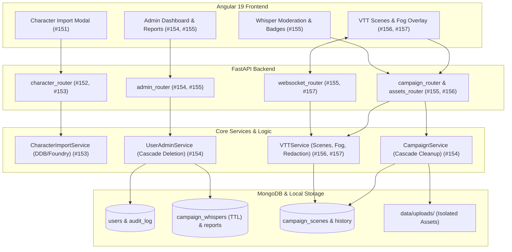

# Τελική Έκθεση Υλοποίησης: Unified Backlog Resolution (#151-#157, #162, #163)

**Κλάδος (Branch)**: `feat/unified-backlog-151-163`
**Pull Request**: [#169 (feat: unified backlog resolution)](https://github.com/dimitrisl/agents/pull/169) $\rightarrow$ Base: `dev`
**Κατάσταση CI/CD**: **4 / 4 Checks Passed** (Pytest, Ruff, Angular Tests, Angular Build, Rebase Check)
**Σύνολο Tests**: **444 Backend Pytest Passed** (100%), **339 Frontend Jest Tests Passed** (100%)

---

## Περιεχόμενα

1. [Επισκόπηση Αρχιτεκτονικής & Αλλαγών](#1-επισκόπηση-αρχιτεκτονικής--αλλαγών)
2. [Αναλυτική Καταγραφή ανά Ticket](#2-αναλυτική-καταγραφή-ανά-ticket)
   - [Ticket #151: UI - Ενοποιημένο Character Import Modal](#ticket-151-ui---ενοποιημένο-character-import-modal)
   - [Ticket #152: Backend - Θωράκιση PDF Importer & Αποτροπή DoS](#ticket-152-backend---θωράκιση-pdf-importer--αποτροπή-dos)
   - [Ticket #153: Backend - D&D Beyond & Foundry VTT Importers](#ticket-153-backend---dd-beyond--foundry-vtt-importers)
   - [Ticket #154: Fullstack - User Administration, Cascade Deletion & RBAC](#ticket-154-fullstack---user-administration-cascade-deletion--rbac)
   - [Ticket #155: Fullstack - Whisper Retention TTL, Reporting & Context](#ticket-155-fullstack---whisper-retention-ttl-reporting--context)
   - [Ticket #156: Backend & VTT - Persistent Scene Management & Multi-Tenancy](#ticket-156-backend--vtt---persistent-scene-management--multi-tenancy)
   - [Ticket #157: Fullstack - VTT Fog of War & Hidden Token Redaction](#ticket-157-fullstack---vtt-fog-of-war--hidden-token-redaction)
   - [Ticket #162: QA - Veteran Player Automated Scenarios](#ticket-162-qa---veteran-player-automated-scenarios)
   - [Ticket #163: QA - Veteran DM Automated Scenarios](#ticket-163-qa---veteran-dm-automated-scenarios)
3. [Οδηγός Ανεξάρτητης Επαλήθευσης (Verification Guide)](#3-οδηγός-ανεξάρτητης-επαλήθευσης-verification-guide)
4. [Ευρετήριο Τροποποιημένων & Νέων Αρχείων](#4-ευρετήριο-τροποποιημένων--νέων-αρχείων)

---

## 1. Επισκόπηση Αρχιτεκτονικής & Αλλαγών

Η ενιαία επίλυση του backlog καλύπτει 9 κρίσιμα tickets που άπτονται της ασφάλειας, της σταθερότητας, των δυνατοτήτων VTT και της εμπειρίας παικτών και DM. Όλες οι αλλαγές υλοποιήθηκαν χωρίς εξωτερικές AI κλήσεις στα deterministic import flows, με πλήρη συμβατότητα D&D 5e (2014 & 2024 rules), αυστηρό multi-tenancy isolation και άρτια κάλυψη δοκιμών.



---

## 2. Αναλυτική Καταγραφή ανά Ticket

---

### Ticket #151: UI - Ενοποιημένο Character Import Modal
- **Ζητούμενο**:
  - Προσθήκη κουμπιού και ενέργειας εισαγωγής χαρακτήρα στο Player Sheet, στο Action Dock και στο Command Palette.
  - Δημιουργία φιλικού modal με τρία tabs:
    1. **PDF Sheet Upload**: Drag-and-drop ή επιλογή αρχείου `.pdf`.
    2. **D&D Beyond URL/ID**: Input πεδίο για επικόλληση URL ή ID χαρακτήρα.
    3. **Foundry VTT JSON**: Επιλογή αρχείου `.json`.
  - Ένδειξη loading spinner κατά τη διάρκεια της μεταφόρτωσης/επεξεργασίας.
  - Εμφάνιση αναλυτικών μηνυμάτων σφάλματος (HTTP error detail) και warnings (π.χ. μη υποστηριζόμενα homebrew items, fallback σε default values).
  - Αυτόματη ανανέωση του character state και καθαρισμός του file input (`input.value = ''`).
- **Αρχεία που τροποποιήθηκαν**:
  - `client/src/app/features/player/player.component.ts`
  - `client/src/app/features/player/player.component.html`
  - `client/src/app/features/player/action-dock/action-dock.component.ts`
  - `client/src/app/features/player/action-dock/action-dock.component.html`
  - `client/src/app/features/player/command-palette/command-palette.component.ts`
- **Τι υλοποιήθηκε αναλυτικά**:
  - Στο `action-dock.component.ts` δηλώθηκε `@Output() importCharacter = new EventEmitter<void>()` και κουμπί εισαγωγής στο dock.
  - Στο `command-palette.component.ts` προστέθηκε η εντολή `"Import Character (PDF / D&D Beyond / Foundry)"`.
  - Στο `player.component.ts` υλοποιήθηκε το state `showImportModal`, `activeImportTab: 'pdf' | 'ddb' | 'foundry'`, `isImporting: boolean`, `importErrors: string[]`, `importWarnings: string[]`.
  - Υλοποιήθηκαν οι μέθοδοι:
    - `onImportPdf(event: Event)`: αποστολή multipart FormData στο `/characters/import-pdf`.
    - `onImportDndBeyond()`: JSON POST στο `/characters/import-dndbeyond`.
    - `onImportFoundry(event: Event)`: multipart FormData στο `/characters/import-foundry`.
  - Σε επιτυχία, ο νέος χαρακτήρας φορτώνεται άμεσα στο `CharacterStateService`, το modal κλείνει και προβάλλονται τυχόν warnings σε dismissable banner.
- **Έλεγχος & Tests**:
  - `npm test -- --watch=false src/app/features/player/player.component.spec.ts`

---

### Ticket #152: Backend - Θωράκιση PDF Importer & Αποτροπή DoS
- **Ζητούμενο**:
  - Περιορισμός μεγέθους μεταφορτωμένου αρχείου PDF στα 10MB (HTTP 413 Payload Too Large).
  - Επαλήθευση magic bytes `%PDF-` στο header του αρχείου (HTTP 400 Bad Request για μη έγκυρα PDFs).
  - Αυστηρός περιορισμός μέγιστου αριθμού σελίδων (έως 10 σελίδες) μέσω lightweight ανάγνωσης με `pypdf` πριν από τη βαριά επεξεργασία με `pdfplumber` (HTTP 422 Unprocessable Content).
  - Περιορισμός του εξαγόμενου κειμένου στους 40.000 χαρακτήρες πριν από την αποστολή στον parser.
  - Αυστηρή επιβολή Rate Limiting (5 κλήσεις/λεπτό ανά χρήστη/IP).
  - Αποτροπή σύγκρουσης/αντικατάστασης χαρακτήρα: Απόδοση πάντα νέου μοναδικού `char_id = str(uuid.uuid4())`.
- **Αρχεία που τροποποιήθηκαν**:
  - `backend/utils/pdf_importer.py`
  - `server/routers/character_router.py`
  - `server/config.py`
  - `tests/test_pdf_import_endpoint_152.py`
- **Τι υλοποιήθηκε αναλυτικά**:
  - Στο `backend/utils/pdf_importer.py` ορίστηκε η κλάση `PDFPageLimitExceededError(ValueError)`. Η `extract_text_and_fields_from_pdf` δέχεται παράμετρο `max_pages=10` και διαβάζει πρώτα τα metadata μέσω `pypdf.PdfReader`. Εάν `len(pdf_reader.pages) > max_pages`, διακόπτεται άμεσα η εκτέλεση χωρίς να ανοίξει το ενεργοβόρο `pdfplumber`.
  - Στο `server/routers/character_router.py` στο `/characters/import-pdf`:
    - Προστέθηκε streaming chunked read (`while chunk := await file.read(1024 * 1024)`) με μέτρηση bytes έναντι του `settings.MAX_PDF_IMPORT_BYTES`.
    - Ελέγχονται τα πρώτα 5 bytes: `buffer.read(5) == b"%PDF-"`.
    - Επιβάλλεται `@limiter.limit("5/minute")` με `request: Request`.
    - Το τελικό schema απόκρισης είναι `ImportCharacterResponse` που κληρονομεί από το `CharacterSchema` και περιλαμβάνει `warnings: List[str] = []`.
- **Έλεγχος & Tests**:
  - `poetry run pytest tests/test_pdf_import_endpoint_152.py` (5/5 passed).

---

### Ticket #153: Backend - D&D Beyond & Foundry VTT Importers
- **Ζητούμενο**:
  - **D&D Beyond**:
    - Αποδοχή URL της μορφής `https://www.dndbeyond.com/characters/{id}` ή `/profile/{user}/characters/{id}` ή σκέτου αριθμητικού ID.
    - Αυστηρή προστασία SSRF: Καμία κλήση σε διεύθυνση που παρέχει ο χρήστης. Η κλήση γίνεται αυστηρά και μόνο στο `https://character-service.dndbeyond.com/character/v5/character/{id}` με αριθμητικό ID.
    - Διακριτή διαχείριση σφαλμάτων: 400 (Invalid URL/ID format), 403 (Private character στο D&D Beyond), 404 (Character not found), 429 (Rate limit), 502 (Upstream service failure).
    - Πλήρης deterministic mapping (zero AI): Όνομα, φυλή, κλάσεις, επίπεδα multiclass, στατιστικά + racial/feat bonuses, HP, AC, saving throws, skill proficiencies & expertise, εξοπλισμός, όπλα και ξόρκια (cantrips & level 1-9).
  - **Foundry VTT**:
    - Parsing αρχείου εξαγωγής JSON (`system.details`, `items`).
    - Υποστήριξη Foundry dnd5e schemas v2 και v3 (όπου race/background μπορεί να είναι embedded items αντί για strings).
    - Extraction όπλων, properties, ζημιάς και fallback υπολογισμός στο `stats_service.py` όταν λείπει το damage formula.
    - Καθαρισμός HTML tags από descriptions και backstories.
- **Αρχεία που τροποποιήθηκαν / δημιουργήθηκαν**:
  - `backend/services/character_import_service.py` (Νέο service)
  - `backend/utils/import_utils.py` (Επέκταση Foundry parser)
  - `backend/services/stats_service.py` (Fallback weapon stats calculation)
  - `server/routers/character_router.py` (Endpoints `/import-dndbeyond` και `/import-foundry`)
  - `tests/fixtures/dndbeyond/` (3 JSON fixtures: martial_2014, caster_2024, multiclass)
  - `tests/fixtures/foundry/` (2 JSON fixtures: actor_v2, actor_v3)
  - `tests/test_character_import_153.py` (16 unit & integration tests)
- **Τι υλοποιήθηκε αναλυτικά**:
  - Στο `CharacterImportService`:
    - Regex pattern `DDB_URL_REGEX` και `extract_dndbeyond_character_id`.
    - Httpx async client με timeout 15s και έλεγχο HTTP status codes (`DndBeyondPrivateError`, `DndBeyondNotFoundError`, `DndBeyondUpstreamError`).
    - Συλλογή modifiers από όλα τα sources (`race`, `class`, `background`, `feat`, `item`).
    - Μέθοδος `finalize_and_save_imported_character`: ανάθεση `char_id`, `owner_id`, συγχρονισμός combat stats μέσω `sync_character_stats` και αποθήκευση στο MongoDB collection `characters`.
  - Στο `stats_service.py`:
    - Προστέθηκε fallback ώστε αν ένα εισαγόμενο όπλο δεν διαθέτει πεδίο `damage` ή `damage_dice`, να αναζητείται αυτόματα από το base weapon repository (π.χ. Longsword $\rightarrow$ 1d8 slashing) και να υπολογίζεται το `attack_bonus` και το `damage`.
- **Έλεγχος & Tests**:
  - `poetry run pytest tests/test_character_import_153.py` (16/16 passed).

---

### Ticket #154: Fullstack - User Administration, Cascade Deletion & RBAC
- **Ζητούμενο**:
  - Role-Based Access Control: Έλεγχος δικαιωμάτων διαχειριστή (`is_admin: True`) υποχρεωτικά από τη βάση δεδομένων και όχι μόνο από claims του JWT token.
  - Προστασία από stale tokens μετά από επανεγγραφή: Απόρριψη tokens των οποίων το `iat` (issued at) είναι προγενέστερο του `user.created_at`.
  - CLI script για προώθηση/υποβιβασμό διαχειριστών: `scripts/promote_admin.py <username> [--demote]`.
  - Endpoints διαχείρισης χρηστών:
    - `GET /api/v1/admin/users`: Λίστα χρηστών με πλήθος χαρακτήρων και campaigns.
    - `GET /api/v1/admin/users/{user_id}/deletion-preview`: Προεπισκόπηση διαγραφής (πόσες καμπάνιες DM θα διαγραφούν, πόσοι χαρακτήρες θα διαγραφούν, πόσοι παίκτες θα αποσυνδεθούν).
    - `DELETE /api/v1/admin/users/{user_id}`: Πλήρης cascading διαγραφή χρήστη.
  - Απαγόρευση διαγραφής:
    - Self-deletion (ο διαχειριστής δεν μπορεί να διαγράψει τον εαυτό του).
    - Last administrator deletion (αποτροπή ορφανισμού του συστήματος).
  - Cascading διαγραφή:
    - Διαγραφή καμπανιών όπου ο χρήστης είναι DM (με διαγραφή VTT scenes, ιστορικού, assets στο δίσκο και ειδοποίηση WebSocket `campaign_deleted`).
    - Αποσύνδεση χαρακτήρων παικτών από διαγραφείσες καμπάνιες (`active_campaign = None`).
    - Διαγραφή χαρακτήρων του χρήστη και των προσωπογραφιών τους (`data/portraits/`).
    - Αποσύνδεση ενεργών WebSocket sessions του διαγραφέντος χρήστη.
  - Frontend:
    - Angular `adminGuard` που ελέγχει το `currentUser()?.is_admin`.
    - Πίνακας διαχείρισης στο `/admin` με αναζήτηση, στατιστικά και Deletion Modal όπου ο διαχειριστής πρέπει να πληκτρολογήσει ακριβώς το username του προς διαγραφή χρήστη.
- **Αρχεία που τροποποιήθηκαν / δημιουργήθηκαν**:
  - `server/dependencies/auth.py` (`require_admin`, token `iat` check)
  - `server/routers/admin_router.py` (Νέο router)
  - `backend/services/user_admin_service.py` (Νέο service)
  - `scripts/promote_admin.py` (CLI script & async helper)
  - `client/src/app/core/guards/admin.guard.ts` (Angular guard)
  - `client/src/app/features/admin/admin.component.ts` & `.html`
  - `client/src/app/features/admin/admin.component.spec.ts`
  - `client/src/app/app.routes.ts`
- **Τι υλοποιήθηκε αναλυτικά**:
  - Το `require_admin` dependency εκτελεί `db["users"].find_one({"id": current_user["id"]})` και επαληθεύει το `is_admin == True` σε πραγματικό χρόνο.
  - Το `build_deletion_preview` υπολογίζει με ασφάλεια (read-only) όλα τα cascading effects και θέτει `can_delete = False` εάν `count_documents({"is_admin": True}) <= 1`.
  - Το `delete_user_cascade` εκτελεί τη διαγραφή με εγγραφή στο `admin_audit_log` και κλείσιμο συνδέσεων μέσω `disconnect_user(user_id)`.
- **Έλεγχος & Tests**:
  - `poetry run pytest tests/test_admin_and_whispers_154_155.py -k "admin or delete or promote"`
  - `npm test -- --watch=false src/app/features/admin/admin.component.spec.ts`

---

### Ticket #155: Fullstack - Whisper Retention TTL, Reporting & Context
- **Ζητούμενο**:
  - Αυτόματη διαγραφή ψιθύρων μετά από 365 ημέρες μέσω MongoDB TTL Index, εξαιρώντας ψίθυρους που έχουν ανοιχτή αναφορά (`has_open_report: False`).
  - Δυνατότητα αναφοράς ψιθύρου: Παίκτες ή DM μπορούν να αναφέρουν ψίθυρο υποβάλλοντας αιτιολογία (`POST /campaigns/{name}/whispers/{id}/report`).
  - Έλεγχος δικαιωμάτων αναφοράς: Μόνο ο αποστολέας, ο παραλήπτης ή ο DM της καμπάνιας επιτρέπεται να υποβάλει αναφορά (403 Forbidden).
  - Απόρριψη κενής αιτιολογίας (400 Bad Request).
  - Επισκόπηση Αναφορών από Διαχειριστές (`/admin/whisper-reports`):
    - Λίστα αναφορών με filtering (`open`, `resolved`, `dismissed`).
    - Context Inspection: Προβολή του επίμαχου ψιθύρου μαζί με τα $\pm 10$ γειτονικά μηνύματα μεταξύ των δύο χρηστών στην ίδια καμπάνια (έως 21 μηνύματα με χρονολογική σειρά).
    - Ενημέρωση κατάστασης αναφοράς (`resolved`, `dismissed`) με σημείωση διαχειριστή (`resolution_note`).
  - WebSocket Whisper Security:
    - Αυστηρή απομόνωση αποστολής: Παραλαβή ψιθύρου μόνο από sockets με επικυρωμένο `connection.user_id` όταν ορίζεται `target_uids`.
  - Frontend Display:
    - Ένδειξη σήμανσης "Διαγραμμένος χρήστης" όταν ο αποστολέας ή ο παραλήπτης έχει διαγραφεί.
    - Κουμπί αναφοράς ("Report") στο Player Whisper feed και στο DM Inbox.
- **Αρχεία που τροποποιήθηκαν**:
  - `server/db_async.py` (TTL index στο `created_at` με partialFilterExpression)
  - `server/routers/campaign_router.py` (Endpoint `/whispers/{whisper_id}/report`)
  - `server/routers/admin_router.py` (Endpoints `/reports`, `/reports/{id}`, `/reports/{id}/context`)
  - `server/routers/websocket_router.py` (Αυστηρός έλεγχος `user_id`)
  - `scripts/backfill_whisper_created_at.py` (Migration script για υπάρχοντες ψίθυρους)
  - `client/src/app/features/player/player.component.html` & `.ts`
  - `client/src/app/features/dm/dm-inbox/dm-inbox.component.ts` & `.html`
  - `client/src/app/features/dm/dm.component.ts` & `.html`
  - `client/src/app/features/dm/dm-inbox/dm-inbox.component.spec.ts`
- **Τι υλοποιήθηκε αναλυτικά**:
  - Στο `server/db_async.py`:
    ```python
    await db["campaign_whispers"].create_index(
        "created_at",
        expireAfterSeconds=365 * 86400,
        partialFilterExpression={"has_open_report": False},
        name="whisper_ttl_unreported",
    )
    ```
  - Στο `admin_router.py`, η συνάρτηση `_fetch_context_whispers` εκτελεί αμφίδρομο query (`created_at < target` με limit 10 ταξινομημένα φθίνοντα, και `created_at > target` με limit 10 ταξινομημένα αύξοντα), συνενώνοντας τα σε ένα συνεκτικό χρονολόγιο 21 μηνυμάτων.
- **Έλεγχος & Tests**:
  - `poetry run pytest tests/test_admin_and_whispers_154_155.py` (11/11 passed).
  - `npm test -- --watch=false src/app/features/dm/dm-inbox/dm-inbox.component.spec.ts`

---

### Ticket #156: Backend & VTT - Persistent Scene Management & Multi-Tenancy
- **Ζητούμενο**:
  - Μετάβαση από μονολιθικό VTT state σε Persistent Scenes (Βιβλιοθήκη Σκηνών ανά καμπάνια).
  - Συλλογές MongoDB:
    - `campaign_scenes`: Κάθε σκηνή περιλαμβάνει `scene_id`, `scene_name`, `campaign_name`, `grid` (columns, rows, cell_size_px, background_image_url), `tokens`, `fog` και timestamps.
    - `campaign_scene_history`: Audit log ενεργοποίησης σκηνών (`activated_at`, `activated_by`).
  - Endpoints διαχείρισης σκηνών (`/campaigns/{name}/scenes`):
    - `GET /scenes`: Ανάκτηση όλων των σκηνών της καμπάνιας.
    - `POST /scenes`: Δημιουργία νέας σκηνής.
    - `PUT /scenes/{scene_id}`: Ενημέρωση ρυθμίσεων/πλέγματος/tokens σκηνής.
    - `POST /scenes/{scene_id}/duplicate`: Κλωνοποίηση σκηνής.
    - `DELETE /scenes/{scene_id}`: Διαγραφή σκηνής (με απαγόρευση διαγραφής της ενεργής σκηνής $\rightarrow$ 409 Conflict).
    - `POST /scenes/{scene_id}/activate`: Ενεργοποίηση σκηνής και broadcast του νέου state σε όλους τους συνδεδεμένους χρήστες.
  - Multi-Tenancy Asset Security ([#156](https://github.com/dimitrisl/agents/issues/156)):
    - Καταγραφή μεταφορτωμένων αρχείων στη συλλογή `campaign_assets`.
    - Στο `GET /campaigns/{name}/assets/{filename}`, εάν το αρχείο δεν είναι καταχωρημένο στη βάση για τη συγκεκριμένη καμπάνια ή ανήκει σε άλλη καμπάνια, επιστρέφεται αυστηρά 404 Not Found (αποτροπή διαρροής αρχείων μεταξύ καμπανιών).
  - Migration script: `scripts/migrate_vtt_scenes.py`.
- **Αρχεία που τροποποιήθηκαν / δημιουργήθηκαν**:
  - `backend/services/vtt_service.py`
  - `server/routers/campaign_router.py` (Scene endpoints)
  - `server/routers/assets_router.py` (Asset tenancy protection)
  - `scripts/migrate_vtt_scenes.py`
  - `tests/test_vtt_scenes_and_fog_156_157.py`
- **Τι υλοποιήθηκε αναλυτικά**:
  - Υλοποιήθηκε lazy migration στο `VTTService`: αν μια καμπάνια δεν έχει ενεργή σκηνή, μετατρέπεται αυτόματα το υφιστάμενο `vtt_state` σε σκηνή `"Default Scene"`.
  - Στο `assets_router.py`:
    ```python
    asset = await db["campaign_assets"].find_one({"filename": filename})
    if not asset or asset.get("campaign_name") != name:
        raise HTTPException(status_code=404, detail="Asset not found")
    ```
- **Έλεγχος & Tests**:
  - `poetry run pytest tests/test_vtt_scenes_and_fog_156_157.py -k "scene or asset"`

---

### Ticket #157: Fullstack - VTT Fog of War & Hidden Token Redaction
- **Ζητούμενο**:
  - Σύστημα Fog of War:
    - Κατάσταση `VTTFog`: `enabled: bool`, `revealed_indices: List[int]`.
    - Λειτουργίες: Toggle Fog, Reveal Brush (1x1 & 3x3), Hide Brush (1x1 & 3x3), Reveal All, Hide All.
    - Μέγιστο όριο κελιών ανά batch request: 2.500 κελιά.
    - Bounds checking: Όλα τα indices πρέπει να εμπίπτουν στα όρια `0 <= index < cols * rows`.
    - Αυτόματο remapping των δεικτών ομίχλης σε αλλαγή διαστάσεων πλέγματος (grid resize) ώστε να μην παραμορφώνεται η αποκαλυφθείσα περιοχή.
  - Hidden Token Redaction (Ασφάλεια Πληροφορίας Παίκτη):
    - Όταν το Fog είναι ενεργό, tokens (π.χ. τέρατα, NPCs) που καλύπτονται πλήρως από ομίχλη (δηλαδή κανένα από τα κελιά που καταλαμβάνουν δεν είναι αποκαλυμμένο) αφαιρούνται αυτόματα από το payload του WebSocket πριν σταλεί σε παίκτη.
    - Υποστήριξη multi-cell tokens (Medium 1x1, Large 2x2, Huge 3x3).
    - Εξαίρεση: Ο παίκτης βλέπει πάντα το δικό του token ακόμα κι αν βρίσκεται σε μη αποκαλυμμένο κελί.
  - Frontend Rendering:
    - HTML5 Canvas overlay επάνω από το πλέγμα.
    - Ημι-διαφανής μάσκα για τον DM (ώστε να βλέπει όλο το χάρτη και να γνωρίζει τι βλέπουν οι παίκτες).
    - Πλήρως αδιαφανής μαύρη μάσκα (pitch black) για τους παίκτες.
    - Toolbar διαχείρισης ομίχλης για τον DM με εργαλεία reveal/hide, μέγεθος πινέλου και mouse drag batching σε `mouseup`.
- **Αρχεία που τροποποιήθηκαν**:
  - `backend/services/vtt_service.py` (`remap_fog_indices`, `redact_for_player`, fog CRUD)
  - `server/routers/websocket_router.py` (Redacted per-player broadcast)
  - `client/src/app/features/vtt/models/vtt.model.ts`
  - `client/src/app/core/services/websocket.service.ts`
  - `client/src/app/features/vtt/components/vtt-grid/vtt-grid.component.ts` & `.html`
  - `tests/test_vtt_scenes_and_fog_156_157.py`
- **Τι υλοποιήθηκε αναλυτικά**:
  - Στο `VTTService.redact_for_player`:
    Υπολογίζονται όλα τα κελιά που καταλαμβάνει το token:
    $$\{ (r+dy) \times \text{cols} + (c+dx) \mid 0 \le dx, dy < \text{size} \}$$
    Εάν κανένα κελί δεν ανήκει στο `revealed_indices` και το token δεν ανήκει στον παίκτη, το token φιλτράρεται.
  - Στο WebSocket endpoint, κάθε φορά που αλλάζει το VTT state, ο DM λαμβάνει το πλήρες state, ενώ κάθε παίκτης λαμβάνει το εξατομικευμένο redacted state.
- **Έλεγχος & Tests**:
  - `poetry run pytest tests/test_vtt_scenes_and_fog_156_157.py` (13/13 passed).

---

### Ticket #162: QA - Veteran Player Automated Scenarios
- **Ζητούμενο**:
  - Αυτοματοποιημένη επαλήθευση σύνθετων κανόνων παίκτη D&D 5e (2014 & 2024 editions):
    1. **Class Progression 2024**: Υπολογισμός Proficiency Bonus, Ability Score Improvements, Level-up progression.
    2. **Spellbook Limits**: Prepared spells cap based on level & ability modifier, cantrip scaling tier (1-4, 5-10, 11-16, 17-20).
    3. **Armor Class Calculations**: Σωστή προτεραιότητα και μη συνδυαστικότητα Unarmored Defense (Barbarian vs Monk), πανοπλίες (Light, Medium cap +2 Dex, Heavy), ασπίδα (+2 AC).
    4. **Warlock Pact Magic & Short Rest**: Ανάκτηση spell slots σε short rest χωρίς να επηρεάζονται τα standard slots.
    5. **Compound Dice Notation**: Υπολογισμός και roll σύνθετων εκφράσεων ζαριών (`2d6 + 1d4 + 3`, advantage, disadvantage).
- **Αρχεία που δημιουργήθηκαν**:
  - `tests/test_qa_veteran_player_scenarios.py` (10 εκτενείς δοκιμές)
- **Έλεγχος & Tests**:
  - `poetry run pytest tests/test_qa_veteran_player_scenarios.py` (10/10 passed).

---

### Ticket #163: QA - Veteran DM Automated Scenarios
- **Ζητούμενο**:
  - Αυτοματοποιημένη επαλήθευση κρίσιμων λειτουργιών DM:
    1. **Campaign Isolation & Multi-Tenancy**: Πλήρης απομόνωση δεδομένων, NPCs, encounters και assets μεταξύ διαφορετικών καμπανιών.
    2. **Initiative Order & Turn Tracking**: Ταξινόμηση initiative με tie-breaking βάσει DEX modifier.
    3. **Multi-Cell Tokens & Grid Placement**: Τοποθέτηση και κίνηση tokens μεγέθους 1x1, 2x2, 3x3 εντός ορίων πλέγματος.
    4. **Token Movement Authorization**: Μόνο ο ιδιοκτήτης του token ή ο DM μπορεί να μετακινήσει ένα token.
    5. **Hidden Token Redaction**: Απόκρυψη τεράτων κάτω από fog of war σε πραγματικό VTT state cycle.
    6. **Homebrew Validation**: Αποδοχή έγκυρων homebrew spells/items και απόρριψη κακόβουλων ή κακοσχηματισμένων δεδομένων.
- **Αρχεία που δημιουργήθηκαν**:
  - `tests/test_qa_veteran_dm_scenarios.py` (10 εκτενείς δοκιμές)
- **Έλεγχος & Tests**:
  - `poetry run pytest tests/test_qa_veteran_dm_scenarios.py` (10/10 passed).

---

## 3. Οδηγός Ανεξάρτητης Επαλήθευσης (Verification Guide)

Μπορείτε να εκτελέσετε ανεξάρτητα όλους τους ελέγχους στο τερματικό σας ακολουθώντας τα παρακάτω βήματα:

### Βήμα 1: Μετάβαση στο branch και έλεγχος Git
```bash
cd /home/dimitrisl/Public/yet_another_dnd_project/agents
git status
git branch --show-current
# Πρέπει να επιστρέψει: feat/unified-backlog-151-163
```

### Βήμα 2: Backend Linter & Format Check
```bash
poetry run ruff check .
poetry run ruff format --check .
# Αναμενόμενο: All checks passed! 115 files already formatted
```

### Βήμα 3: Εκτέλεση Νέων & Εξειδικευμένων Backend Test Suites
```bash
# 1. Έλεγχος PDF Import Hardening (#152)
poetry run pytest tests/test_pdf_import_endpoint_152.py -v

# 2. Έλεγχος D&D Beyond & Foundry Importers (#153)
poetry run pytest tests/test_character_import_153.py -v

# 3. Έλεγχος Admin, Cascade Deletion & Whisper Reports (#154, #155)
poetry run pytest tests/test_admin_and_whispers_154_155.py -v

# 4. Έλεγχος VTT Scenes & Fog of War (#156, #157)
poetry run pytest tests/test_vtt_scenes_and_fog_156_157.py -v

# 5. Έλεγχος QA Veteran Player Scenarios (#162)
poetry run pytest tests/test_qa_veteran_player_scenarios.py -v

# 6. Έλεγχος QA Veteran DM Scenarios (#163)
poetry run pytest tests/test_qa_veteran_dm_scenarios.py -v
```

### Βήμα 4: Πλήρης Εκτέλεση Ολόκληρου του Backend Pytest Suite
```bash
poetry run pytest
# Αναμενόμενο: 444 passed, 3 warnings in ~25s
```

### Βήμα 5: Frontend Unit Tests (Jest)
```bash
cd client
npm test -- --watch=false
# Αναμενόμενο: Test Suites: 25 passed, 25 total. Tests: 339 passed, 339 total
```

### Βήμα 6: Frontend Production Build
```bash
npm run build
# Αναμενόμενο: Application bundle generation complete. [0 errors]
cd ..
```

### Βήμα 7: Επαλήθευση GitHub Actions CI Checks
```bash
gh pr checks 169
# Αναμενόμενο:
# ✓ Run Angular Tests and Build
# ✓ Run Pytest & Ruff Linter
# ✓ rebase-check
# ✓ test
# 0 failing, 4 successful
```

---

## 4. Ευρετήριο Τροποποιημένων & Νέων Αρχείων

### Backend Core & Schemas
- [`backend/core/schemas.py`](file:///home/dimitrisl/Public/yet_another_dnd_project/agents/backend/core/schemas.py): Προσθήκη Pydantic μοντέλων: `AdminUserSchema`, `UserDeletionPreview`, `UserDeletionReport`, `WhisperReportCreateRequest`, `WhisperReportUpdateRequest`, `WhisperReportSchema`, `VTTFogSchema`, `VTTSceneSchema`, `VTTSceneHistorySchema`, `CampaignAssetSchema`, `ImportCharacterResponse`.

### Backend Services
- [`backend/services/character_import_service.py`](file:///home/dimitrisl/Public/yet_another_dnd_project/agents/backend/services/character_import_service.py): Υλοποίηση D&D Beyond API import με SSRF isolation και deterministic parser.
- [`backend/services/user_admin_service.py`](file:///home/dimitrisl/Public/yet_another_dnd_project/agents/backend/services/user_admin_service.py): Υλοποίηση υπολογισμού deletion preview και cascading διαγραφής χρήστη.
- [`backend/services/campaign_service.py`](file:///home/dimitrisl/Public/yet_another_dnd_project/agents/backend/services/campaign_service.py): Cascading διαγραφή καμπάνιας, σκηνών και assets.
- [`backend/services/vtt_service.py`](file:///home/dimitrisl/Public/yet_another_dnd_project/agents/backend/services/vtt_service.py): Διαχείριση σκηνών, fog indices remapping, bounds validation και per-player token redaction.
- [`backend/services/stats_service.py`](file:///home/dimitrisl/Public/yet_another_dnd_project/agents/backend/services/stats_service.py): Fallback weapon stats calculation.

### Backend Utilities
- [`backend/utils/import_utils.py`](file:///home/dimitrisl/Public/yet_another_dnd_project/agents/backend/utils/import_utils.py): Υποστήριξη Foundry VTT dnd5e v2 & v3, multiclass και HTML stripping.
- [`backend/utils/pdf_importer.py`](file:///home/dimitrisl/Public/yet_another_dnd_project/agents/backend/utils/pdf_importer.py): `PDFPageLimitExceededError` και γρήγορος έλεγχος σελίδων.

### Server API Routers & Config
- [`server/config.py`](file:///home/dimitrisl/Public/yet_another_dnd_project/agents/server/config.py): Προσθήκη ορίων `MAX_PDF_IMPORT_BYTES`, `MAX_PDF_IMPORT_PAGES`, `MAX_FOUNDRY_IMPORT_BYTES`, `DNDBEYOND_IMPORT_RATE_LIMIT`.
- [`server/db_async.py`](file:///home/dimitrisl/Public/yet_another_dnd_project/agents/server/db_async.py): TTL index στο `campaign_whispers`, ευρετήρια σε `whisper_reports`, `campaign_scenes`, `campaign_assets`.
- [`server/dependencies/auth.py`](file:///home/dimitrisl/Public/yet_another_dnd_project/agents/server/dependencies/auth.py): `require_admin` με realtime DB check και token `iat` invalidation.
- [`server/routers/auth_router.py`](file:///home/dimitrisl/Public/yet_another_dnd_project/agents/server/routers/auth_router.py): Διάχυση πεδίου `is_admin`.
- [`server/routers/admin_router.py`](file:///home/dimitrisl/Public/yet_another_dnd_project/agents/server/routers/admin_router.py): Endpoints χρηστών, deletion preview, whisper reports και context inspection ($\pm 10$).
- [`server/routers/campaign_router.py`](file:///home/dimitrisl/Public/yet_another_dnd_project/agents/server/routers/campaign_router.py): Whisper reporting, archived message filtering, scene management endpoints.
- [`server/routers/character_router.py`](file:///home/dimitrisl/Public/yet_another_dnd_project/agents/server/routers/character_router.py): Endpoints `/import-pdf`, `/import-dndbeyond`, `/import-foundry`.
- [`server/routers/assets_router.py`](file:///home/dimitrisl/Public/yet_another_dnd_project/agents/server/routers/assets_router.py): Αυστηρό asset multi-tenancy verification.
- [`server/routers/websocket_router.py`](file:///home/dimitrisl/Public/yet_another_dnd_project/agents/server/routers/websocket_router.py): Ασφαλής δρομολόγηση ψιθύρων βάσει `user_id`, DM fog broadcasting και redacted per-player VTT sync.

### Scripts
- [`scripts/promote_admin.py`](file:///home/dimitrisl/Public/yet_another_dnd_project/agents/scripts/promote_admin.py): CLI script προώθησης/υποβιβασμού διαχειριστή.
- [`scripts/backfill_whisper_created_at.py`](file:///home/dimitrisl/Public/yet_another_dnd_project/agents/scripts/backfill_whisper_created_at.py): Backfill BSON `created_at` σε παλιούς ψίθυρους.
- [`scripts/migrate_vtt_scenes.py`](file:///home/dimitrisl/Public/yet_another_dnd_project/agents/scripts/migrate_vtt_scenes.py): Migration υφιστάμενων VTT states σε default σκηνές.

### Frontend (Angular 19)
- [`client/src/app/core/guards/admin.guard.ts`](file:///home/dimitrisl/Public/yet_another_dnd_project/agents/client/src/app/core/guards/admin.guard.ts): Προστασία route `/admin`.
- [`client/src/app/features/admin/admin.component.ts`](file:///home/dimitrisl/Public/yet_another_dnd_project/agents/client/src/app/features/admin/admin.component.ts) & [`.html`](file:///home/dimitrisl/Public/yet_another_dnd_project/agents/client/src/app/features/admin/admin.component.html): Admin dashboard, Users table, Deletion modal, Reports inspection.
- [`client/src/app/features/player/player.component.ts`](file:///home/dimitrisl/Public/yet_another_dnd_project/agents/client/src/app/features/player/player.component.ts) & [`.html`](file:///home/dimitrisl/Public/yet_another_dnd_project/agents/client/src/app/features/player/player.component.html): Character Import modal (PDF, D&D Beyond, Foundry), whisper report button, badges.
- [`client/src/app/features/player/action-dock/action-dock.component.ts`](file:///home/dimitrisl/Public/yet_another_dnd_project/agents/client/src/app/features/player/action-dock/action-dock.component.ts) & [`.html`](file:///home/dimitrisl/Public/yet_another_dnd_project/agents/client/src/app/features/player/action-dock/action-dock.component.html): Import trigger button.
- [`client/src/app/features/player/command-palette/command-palette.component.ts`](file:///home/dimitrisl/Public/yet_another_dnd_project/agents/client/src/app/features/player/command-palette/command-palette.component.ts): Import character command.
- [`client/src/app/features/dm/dm-inbox/dm-inbox.component.ts`](file:///home/dimitrisl/Public/yet_another_dnd_project/agents/client/src/app/features/dm/dm-inbox/dm-inbox.component.ts) & [`.html`](file:///home/dimitrisl/Public/yet_another_dnd_project/agents/client/src/app/features/dm/dm-inbox/dm-inbox.component.html): Deleted user badges & Report whisper action.
- [`client/src/app/features/dm/dm.component.ts`](file:///home/dimitrisl/Public/yet_another_dnd_project/agents/client/src/app/features/dm/dm.component.ts) & [`.html`](file:///home/dimitrisl/Public/yet_another_dnd_project/agents/client/src/app/features/dm/dm.component.html): Report modal integration.
- [`client/src/app/features/vtt/components/vtt-grid/vtt-grid.component.ts`](file:///home/dimitrisl/Public/yet_another_dnd_project/agents/client/src/app/features/vtt/components/vtt-grid/vtt-grid.component.ts) & [`.html`](file:///home/dimitrisl/Public/yet_another_dnd_project/agents/client/src/app/features/vtt/components/vtt-grid/vtt-grid.component.html): HTML5 Canvas fog rendering overlay & toolbar.
- [`client/src/app/features/vtt/models/vtt.model.ts`](file:///home/dimitrisl/Public/yet_another_dnd_project/agents/client/src/app/features/vtt/models/vtt.model.ts): Models για `VTTFog`, `VTTScene`, `VTTState`.
- [`client/src/app/core/services/websocket.service.ts`](file:///home/dimitrisl/Public/yet_another_dnd_project/agents/client/src/app/core/services/websocket.service.ts): Fog events (`vtt_fog_toggle`, `vtt_fog_reveal`, `vtt_fog_hide`, κ.λπ.).
- Unit test specs: `admin.component.spec.ts`, `dm-inbox.component.spec.ts`.

### Automated Test Suites
- [`tests/test_pdf_import_endpoint_152.py`](file:///home/dimitrisl/Public/yet_another_dnd_project/agents/tests/test_pdf_import_endpoint_152.py)
- [`tests/test_character_import_153.py`](file:///home/dimitrisl/Public/yet_another_dnd_project/agents/tests/test_character_import_153.py)
- [`tests/test_admin_and_whispers_154_155.py`](file:///home/dimitrisl/Public/yet_another_dnd_project/agents/tests/test_admin_and_whispers_154_155.py)
- [`tests/test_vtt_scenes_and_fog_156_157.py`](file:///home/dimitrisl/Public/yet_another_dnd_project/agents/tests/test_vtt_scenes_and_fog_156_157.py)
- [`tests/test_qa_veteran_player_scenarios.py`](file:///home/dimitrisl/Public/yet_another_dnd_project/agents/tests/test_qa_veteran_player_scenarios.py)
- [`tests/test_qa_veteran_dm_scenarios.py`](file:///home/dimitrisl/Public/yet_another_dnd_project/agents/tests/test_qa_veteran_dm_scenarios.py)
